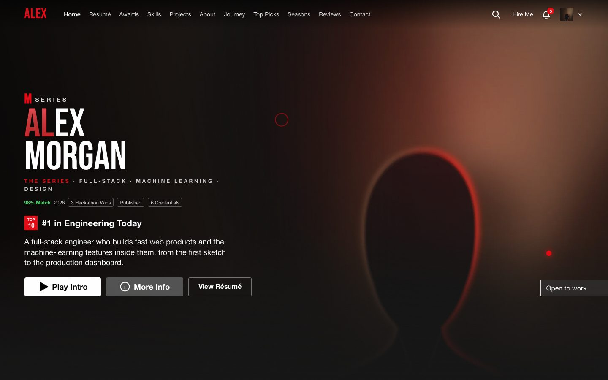
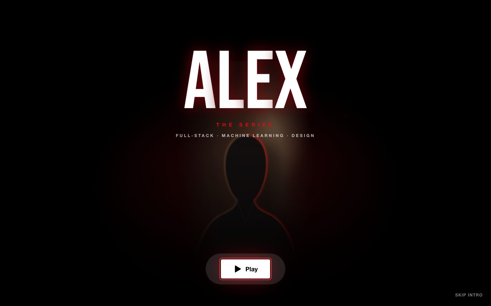
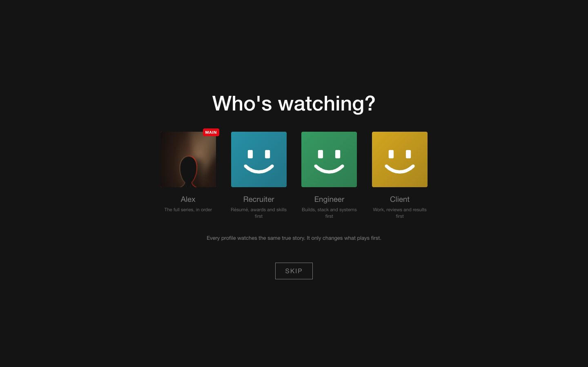
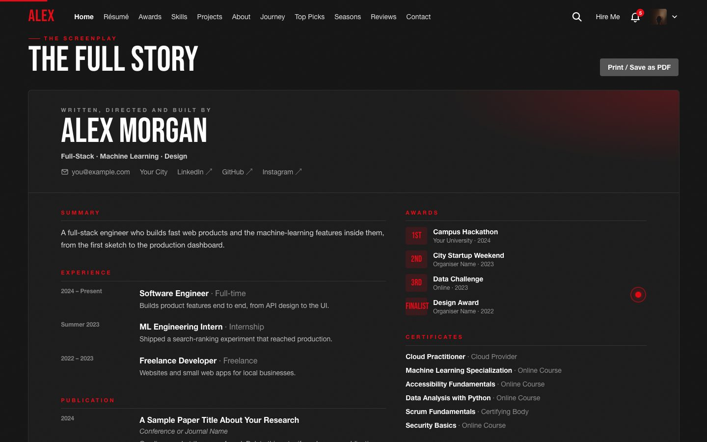
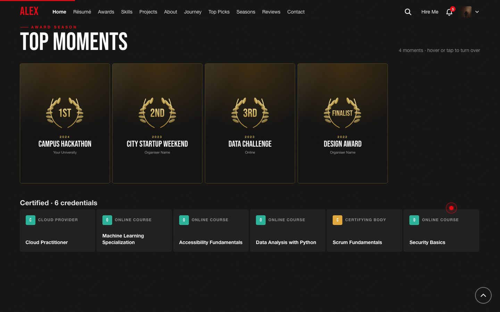
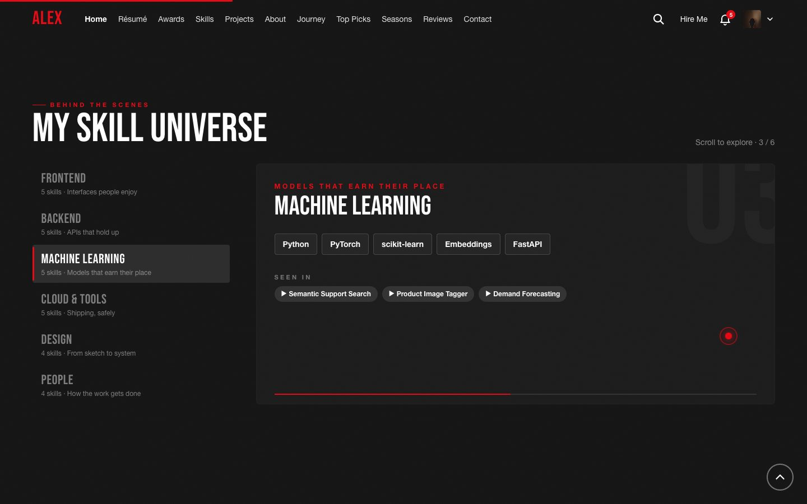
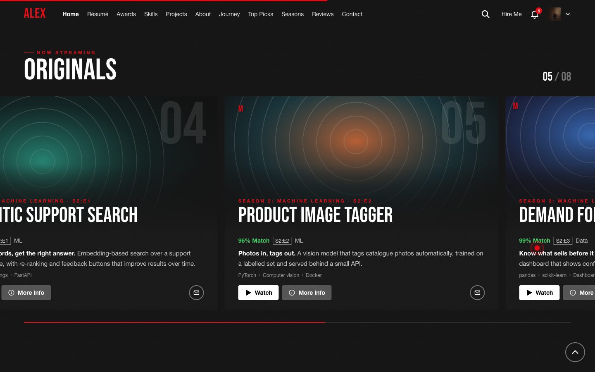
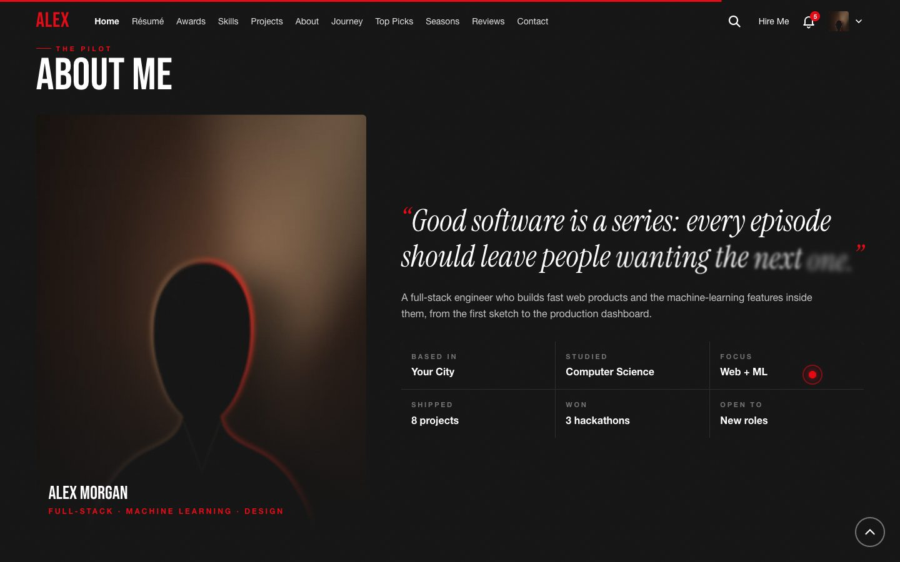
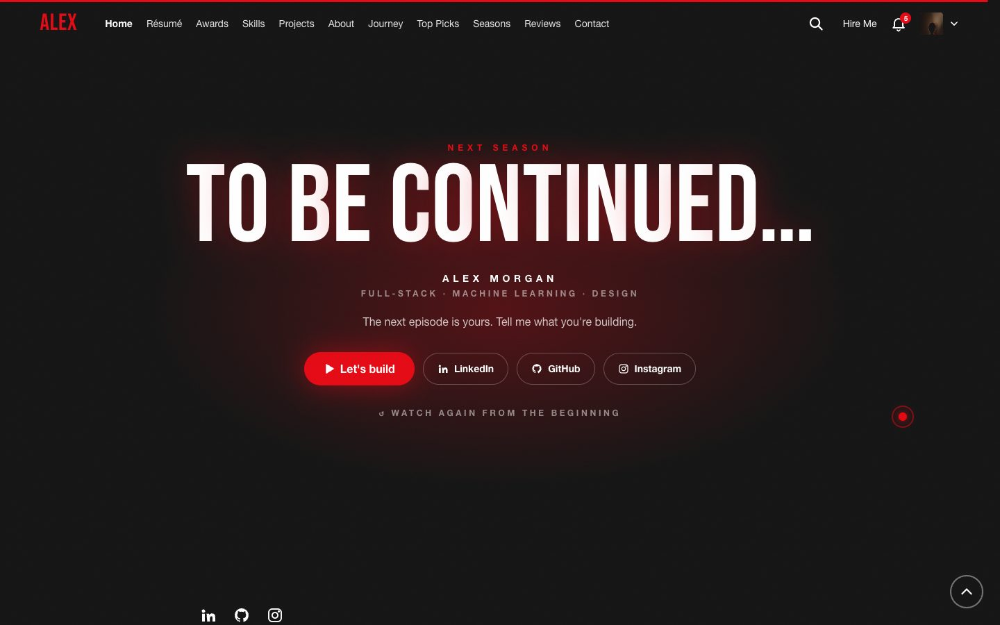
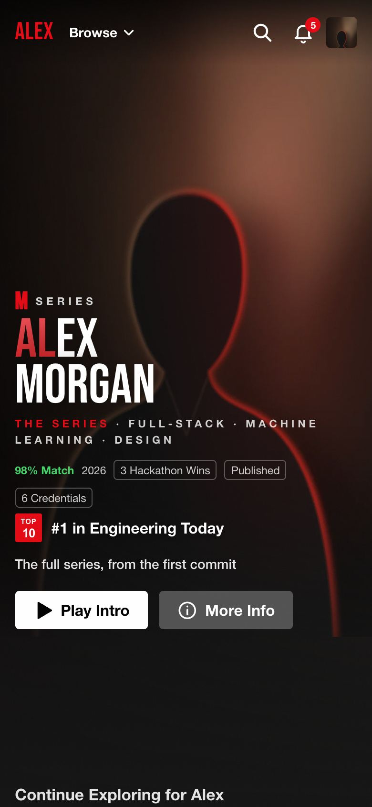

<div align="center">

# SHOWRUNNER

**Your portfolio, as a streaming series.**

A free, open-source portfolio template that plays like the streaming app on your TV.
You're the show, your projects are the episodes, and every visitor gets a cut made for them.
Edit one file, deploy, done.

[Live demo](https://abbishekk-dgs.github.io/showrunner/) · [Make it yours](#make-it-yours) · [Deploy](#deploy)

[](https://vercel.com/new/clone?repository-url=https://github.com/Abbishekk-DGS/showrunner)



<sub>The demo uses a made-up person, "Alex Morgan", and a placeholder photo. Swap in your own.</sub>

</div>

## Start to end

The site plays like an episode: a cold open, a profile picker, then one long, cinematic scroll.

| | |
| --- | --- |
| **Opening** | Black screen. Your name burns in letter by letter through a blur, a red glow wakes up, your photo rises behind it, and "The Series" and your role line fade in. Then ▶ Play. Once per session; Skip or Enter jump past it. |
| **Who's watching?** | Your own profile (your photo, marked MAIN) plus Recruiter, Engineer and Client. Each one reorders the whole page and changes the billboard line. |
| **Billboard** | Name with a red-gradient highlight, role line, % Match and fact chips, a TOP 10 badge, synopsis, then Play Intro, More Info and View Résumé. Parallax as you scroll. |
| **Continue Exploring** | One card per section in this viewer's order. Each red bar fills as the visitor actually scrolls through that section. |
| **The Full Story** | Your résumé as a designed sheet: experience, publications, education, awards, certificates and skills. **Print / Save as PDF** prints just the sheet, in black on white. |
| **Top Moments** | Awards as gold-laurel posters with the placing in the wreath; hover or tap to flip one over. Then a **Certified** rail of every credential. |
| **My Skill Universe** | Pins to the screen; scrolling steps through your skill groups one at a time, and "Seen in" links open the projects that use them. |
| **Originals** | Pins to the screen; scrolling moves your projects sideways as big feature cards. Swipe on phones. |
| **About Me** | The photo drifts against the scroll, a serif quote writes itself in, then the facts. |
| **My Journey** | Your story in seasons. Pick a season and its episodes deal in. |
| **Top Picks** | Your best projects, ranked, with big hollow numerals. |
| **All Seasons, Critically Acclaimed** | Every project in streaming-style rows with hover previews, then your reviews. |
| **To be continued…** | The ending burns in over a red glow, with Let's build, your socials, and "Watch again from the beginning". |

Everywhere: a red dot-and-ring cursor, smooth scrolling, a scroll progress line and a back-to-top button.

**It all works:** hover preview cards, My List, Continue Watching (progress fills as people read a project), search (`/`), notifications, Explore All, share links (`?ep=project`, `?for=recruiter`), and a player-style trailer with a clickable scrubber.

<p>
  
  
</p>
<p>
  
  
</p>
<p>
  
  
</p>
<p>
  
  
</p>
<p align="center"></p>

## Make it yours

**1. Get the code.** Click **Use this template** on GitHub (or fork it), then:

```bash
git clone https://github.com/<you>/<your-repo>.git
cd <your-repo>
npm install
npm run dev          # http://localhost:5173
```

**2. Edit one file: [`src/config/portfolio.ts`](src/config/portfolio.ts).**
Everything in it is sample content for "Alex Morgan". It's commented throughout, and [`types.ts`](src/config/types.ts) explains every field, so your editor flags anything missing.

| To change… | Edit in `portfolio.ts` |
| --- | --- |
| Name, wordmark, title, role line, synopsis, email, socials | `profile` |
| Your photo | Put a tall (about 9:16) image in `public/media/` and set `profile.portrait` (and optionally `portraitSmall`, a ~640px copy for phones) |
| A résumé PDF download | Put the PDF in `public/` and set `profile.resume` |
| The TOP 10 line and "% Match" | `profile.rank`, `profile.match` (delete `rank` to hide the badge) |
| Colours and fonts | `theme` (any colour; any Google Font) |
| Projects | `seasons` → `episodes`. Each season becomes a row. Add `image` for a screenshot, `links` for buttons, `badge` for a ribbon |
| Résumé sheet | `education`, `experience`, `publications` |
| Awards and credentials | `awards` (posters), `credentials` (the Certified rail; add `link` for a credential URL) |
| Skill groups | `skills`. `seenIn` links each group to projects |
| About, Journey, Top Picks, ending | `about`, `journey`, `topPicks`, `outro` |
| Profiles and their section order | `viewers`. To drop a section, remove its id from every `order` |
| Section kickers, titles and nav labels | `sections` |
| Trailer slides | `trailer` |
| Reviews and footer links | `reviews`, `footerLinks` |
| Cursor and smooth scrolling | `theme.cursor`, `theme.smoothScroll` |
| Skip the opening or the profile picker | `intro.enabled`, `intro.askWhoIsWatching` |

Empty lists hide their section, so you can start with just projects and add awards or reviews later.

**3. Finish the details.** In `index.html`, set the `<title>`, description and preview tags (`og:image` and `og:url` need your site's full URL). Replace `public/media/og.jpg` (1200 × 630) and `public/favicon.svg`.

## Deploy

It's a static site: `npm run build` writes everything to `dist/`.

- **Vercel:** click the button at the top, or import your repo at vercel.com/new. No settings needed.
- **GitHub Pages (included):** push to `main`, then open **Settings → Pages** and set **Source** to **GitHub Actions**. The workflow in `.github/workflows/deploy.yml` publishes on every push to `https://<you>.github.io/<repo>/`.
- **Netlify / Cloudflare Pages:** build command `npm run build`, output folder `dist`.
- **Custom domain on GitHub Pages:** remove the `BASE_PATH` line from the workflow.

## Under the hood

React 18 · TypeScript · Vite 6 · Tailwind CSS 4 · Framer Motion · Lenis. No backend and no tracking; My List, Continue Watching and the chosen profile live in the visitor's own browser.

```
src/
  config/portfolio.ts   ← everything you edit
  config/types.ts       ← what each field means
  components/           ← opening, billboard, rows, sections, player, modal…
  lib/                  ← search, My List, progress, smooth scroll, photo fades
```

- **Works in every modern browser**, Safari included. The photo fades are painted with a canvas instead of CSS masks, which Safari drops on animated images.
- **Accessible:** keyboard support throughout. Dialogs trap focus and close on Escape, and motion calms down under `prefers-reduced-motion`.
- **Touch-friendly:** rows swipe, pinned sections become simple lists on phones, and hover-only effects stay on mouse and trackpad.

## Contributing

Ideas, fixes and new sections are welcome. See [CONTRIBUTING.md](CONTRIBUTING.md).
Built your portfolio with Showrunner? Open an issue with the link.

## Credits

Made by [Abbishekk DGS](https://github.com/Abbishekk-DGS). The "portfolio as a series" idea was inspired by
[Sushmita Dasari's portfolio](https://github.com/Sushmitadasari/Portfolio_series); this is an independent implementation written from scratch.

Showrunner imitates the general look of streaming apps for personal portfolios. It is not affiliated with Netflix or any other streaming service, and uses none of their logos, fonts, sounds or other assets.

[MIT](LICENSE) © 2026 Abbishekk DGS
